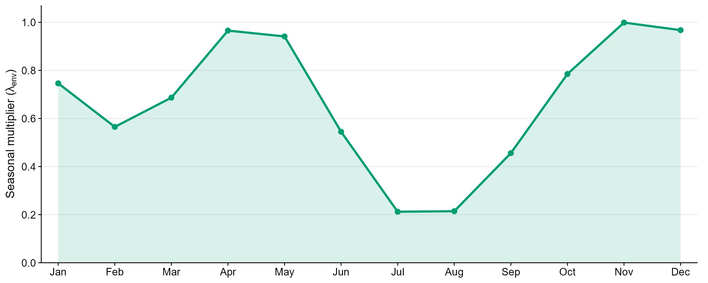
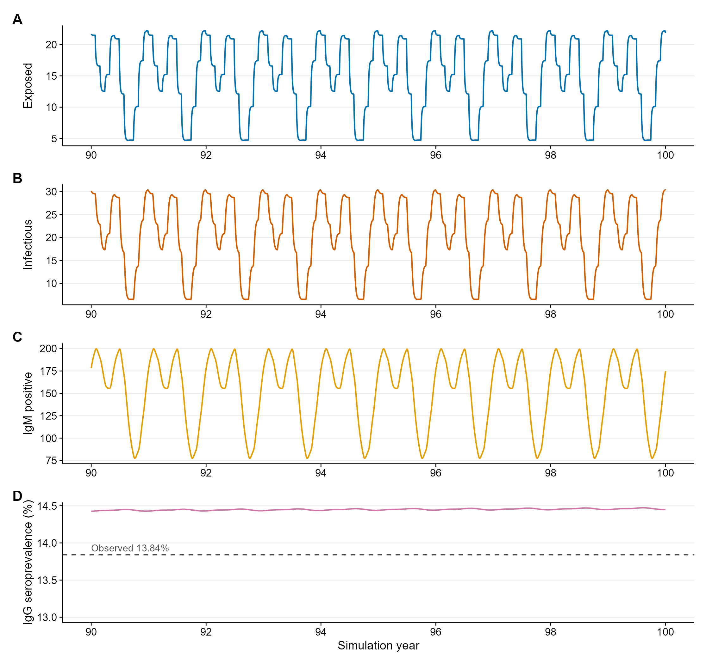
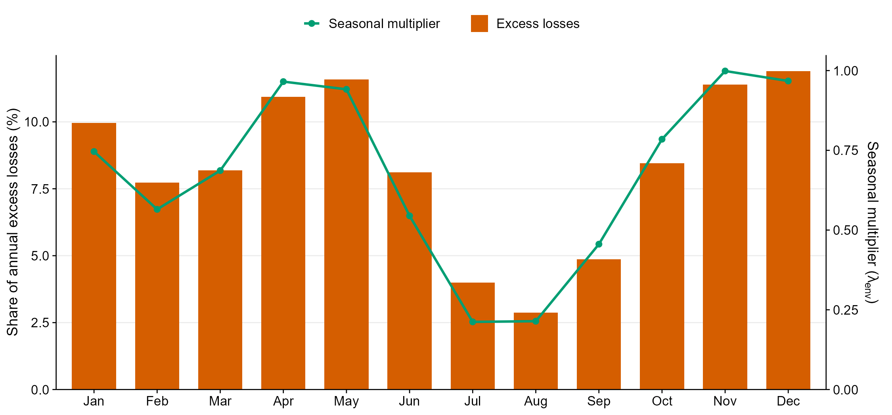
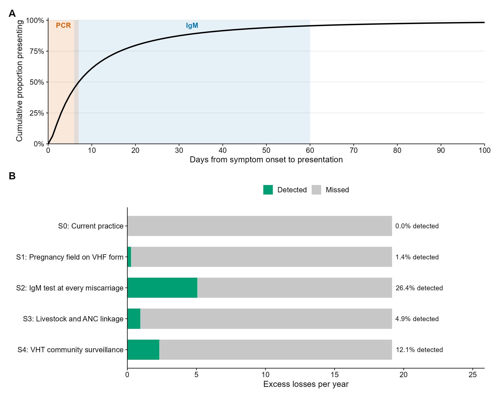

# Estimating the hidden burden of Rift Valley fever on pregnancy loss in Isingiro District, Uganda

A three-model mathematical framework that estimates how many pregnancy losses each year are attributable to Rift Valley fever virus (RVFV) infection among women in Isingiro District, Uganda, how those losses are distributed through the year, and how many of them alternative surveillance strategies could detect.

**Author:** Shakira Babirye
**Supervisors:** Prof. Betty Kivumbi and Abel Wilson Walekhwa
**Affiliations:** Uganda National Institute of Public Health (UNIPH) fellowship; Infectious Diseases Research Collaboration (IDRC)

**Status:** manuscript in preparation. Code and outputs are version 2.3 (07 October 2026).

## Research questions

1. How many pregnancy losses per year in Isingiro are attributable to RVFV infection during pregnancy?
2. How are these losses distributed through the year in relation to vegetation (NDVI) driven seasonality of transmission?
3. What proportion of these losses does current surveillance detect, and how much would alternative strategies detect?
4. Which uncertain parameters most affect the estimate, and therefore which data should be collected next?

## Approach

| Component | What it does | Output passed on |
|---|---|---|
| Environmental forcing | Converts MODIS satellite NDVI for the 22 sub-counties into a monthly multiplier of infection risk, using functional data analysis (functional PCA and clustering of sub-county NDVI curves) | Seasonal multiplier λ_env(t) |
| Model 1: transmission (SEIR₁R₂) | Simulates RVFV infection in the district population; the force of infection is fitted to age-specific IgG seroprevalence with a catalytic model | Force of infection λ(t) |
| Model 2: pregnancy and excess loss (SEIR₁R₂ + L) | Applies λ(t) to pregnant women and counts losses above the background miscarriage rate | Annual RVF-attributable excess losses |
| Model 3: detection cascade | Estimates the share of these losses detected under five surveillance scenarios | Detected and missed losses |
| Sensitivity analysis | Morris screening and Sobol variance decomposition | Parameters that drive uncertainty |

No new primary data were collected. All inputs come from published studies, national surveys, and satellite data; every parameter and its source is listed in the "Parameters and data sources" section of the report.

## Repository contents

```
RVF_Models_Isingiro_Uganda_v2.3_07Oct2026.Rmd    main analysis (all three models and sensitivity analysis)
RVF_Models_Isingiro_Uganda_v2.3_07Oct2026.html   rendered report
ndvi_climate_code/                                script that downloads and processes MODIS NDVI (AppEEARS API)
data/                                             NDVI time series, FDA outputs, sub-county points, boundary shapefiles
outputs_v2.3_07Oct2026/                           figures (PNG, 300 dpi) and all tables (Word)
```

## Selected figures

| | |
|---|---|
|  |  |
|  |  |

## How to run

1. Install R 4.4 or later and RStudio.
2. Clone or download this repository and keep the `.Rmd` file next to the `data/` folder.
3. Open `RVF_Models_Isingiro_Uganda_v2.3_07Oct2026.Rmd` in RStudio and click **Knit**. Missing packages are installed on the first run (internet needed). A full run takes about 15 minutes; later runs reuse the knitr cache.

Main packages: `deSolve`, `tidyverse`, `sensitivity`, `lhs`, `fda`, `sf`, `patchwork`, `flextable`, `officer`.

The NDVI data are already included, so the download script does not need to be re-run. To re-run it, create a free NASA Earthdata account and set `EARTHDATA_USER` and `EARTHDATA_PASS` as environment variables (for example in `~/.Renviron`); credentials are never stored in the code.

## Data sources and licences

- **Vegetation index:** MODIS MOD13Q1 v061 (250 m, 16-day NDVI), NASA LP DAAC, accessed through AppEEARS. NASA data are freely available without restriction.
- **Administrative boundaries:** geoBoundaries, Uganda ADM3 and ADM4 (CC BY 4.0). See the `CITATION-AND-USE-geoBoundaries.txt` files in `data/shapefiles/`.
- **Epidemiological parameters:** published literature, the Uganda Demographic and Health Survey 2022, and the 2024 National Population and Housing Census, as cited in the report.

## Limitations

The force of infection relies on one seroprevalence survey with assumed age-group mid-points and constant transmission over time; the miscarriage risk ratio comes from a single small hospital study; presentation delays and detection probabilities are assumptions; and there are no observed data on RVF-linked pregnancy loss in Uganda to validate the model. Estimates should therefore be read as ranges (see the sensitivity analysis).

## Licence

Code is released under the MIT Licence (see `LICENSE`). Data files keep the licences of their original sources listed above.

## Citation

If you use this code, please cite: Babirye S, Kivumbi B, Walekhwa AW. *Estimating the hidden burden: modelling Rift Valley fever-attributable excess pregnancy loss among women in Isingiro District, Uganda.* Manuscript in preparation, 2026. Code: https://github.com/Shakira25/rvf-pregnancy-loss-isingiro
